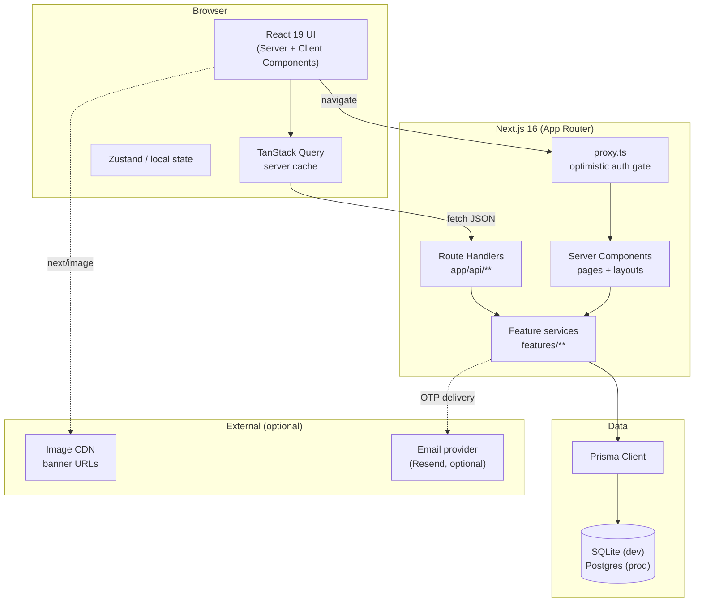

# Architecture

## Overview

Evently is a single Next.js (App Router) application that serves both the React UI and the
HTTP API from the same codebase. There is no separate backend service: Route Handlers under
`app/api/**` are the backend "controllers", feature services under `features/**` hold the
business logic, and Prisma is the only data access layer.



## Stack

| Layer         | Technology                   | Version      | Why                                            |
| ------------- | ---------------------------- | ------------ | ---------------------------------------------- |
| Framework     | Next.js (App Router)         | 16.4.3       | One codebase for UI + API, RSC, file routing   |
| Language      | TypeScript                   | 5.x (strict) | Type safety across client and server           |
| Styling       | Tailwind CSS                 | v4           | Design tokens, responsive utilities            |
| UI primitives | shadcn-style components      | —            | Owned components, no runtime UI dependency     |
| Server state  | TanStack Query               | v5           | Caching, refetch after mutations               |
| Auth          | Custom JWT (`jose`) + bcrypt | —            | httpOnly cookies, refresh rotation             |
| ORM           | Prisma                       | 6.19         | Typed queries, migrations                      |
| Database      | SQLite → Postgres            | —            | Zero-setup local dev, managed Postgres in prod |
| Validation    | Zod                          | v4           | One schema for forms _and_ API                 |
| Charts        | Recharts                     | v3           | Dashboard visualisations                       |
| QR            | `qrcode.react`               | v4           | Client-rendered tickets                        |
| Tests         | Vitest + Testing Library     | v5           | Fast unit/component tests                      |

## Directory structure

```
app/
  layout.tsx              Root shell: providers, theme init, toasts
  (public)/               Marketing + browse routes (header/footer shell)
    page.tsx              Landing page
    events/               Explore + event detail
    for-organizers/       About / FAQ / contact / legal
  (auth)/                 Sign in, sign up, forgot/reset password, verify email
  (dashboard)/            Authenticated shell (sidebar)
    dashboard/            Role-based dashboard
    bookings/ tickets/ profile/ saved/ checkout/
    organizer/            Events, create, analytics, check-in
    admin/                Approvals, users, platform stats
  api/                    Route handlers (the backend API)
components/
  ui/                     Design-system primitives
  *.tsx                   App shell pieces (header, footer, sidebar, theme)
features/
  auth/ events/ bookings/ tickets/ organizer/ admin/ dashboard/ profile/
                          Feature code: *.schema.ts, *.service.ts, components/
  <feature>.api.ts        Typed client wrappers for the API
hooks/ lib/ store/ types/ Utilities, config, shared domain types
prisma/                   schema.prisma, migrations, seed.ts
docs/                     Architecture, flows, ER diagram, API docs
```

Each feature folder follows the same shape: a **schema** (Zod contracts), a **service**
(business logic + Prisma access) and **components** (UI). Route handlers stay thin — they
parse input, call a service, and shape the response.

## Key flows

### Authentication

1. `POST /api/auth/login` verifies the bcrypt hash and issues an access JWT (15 min) plus an
   opaque refresh token (7 days).
2. Both are written as `httpOnly`, `SameSite=Lax` cookies (`ev_access`, `ev_refresh`). No
   token ever touches `localStorage`.
3. `proxy.ts` performs an optimistic check on protected prefixes and redirects to
   `/login?next=…` when no session cookie is present.
4. Authoritative checks live in `requireUser` / `requireRole` / `requireOrganizer`, called by
   every protected route handler and page.
5. `POST /api/auth/refresh` rotates the refresh token (single-use) and issues a new pair.

### Booking with an atomic seat hold

1. `POST /api/bookings/holds` prices the basket, then performs a conditional update:
   `UPDATE "TicketType" SET sold = sold + n WHERE id = ? AND sold + n <= quantity`.
   Zero rows affected ⇒ the seats just sold out, and the request fails.
2. A `PENDING` booking plus a `SeatHold` expiring in 10 minutes are created in the same
   transaction.
3. `POST /api/bookings/:id/checkout` simulates a payment, records a `Payment` row (method +
   reference only — never card/UPI data), marks the booking `CONFIRMED`, and issues one
   `Ticket` per seat, each with a unique QR token.
4. `releaseExpiredHolds()` runs lazily before availability reads, returning unpaid holds to
   inventory.

## Configuration

| File                                    | Controls                               |
| --------------------------------------- | -------------------------------------- |
| `next.config.ts`                        | Image hosts, Turbopack CSS loader      |
| `proxy.ts`                              | Protected route prefixes + matcher     |
| `prisma/schema.prisma`                  | Database provider + models             |
| `.env` (gitignored)                     | Secrets: DB URL, JWT secrets, TTLs     |
| `eslint.config.mjs`, `.prettierrc.json` | Lint + format rules                    |
| `vitest.config.mts`                     | Test environment, path alias, coverage |

## Deployment

- **App:** Vercel (`pnpm build`), or any Node host.
- **Database:** managed Postgres (Neon / Supabase / Railway). Switch
  `datasource.provider` to `postgresql`, point `DATABASE_URL` at it, then
  `pnpm prisma migrate deploy`.
- **Secrets:** set `DATABASE_URL`, `JWT_ACCESS_SECRET`, `JWT_REFRESH_SECRET` and
  `NEXT_PUBLIC_APP_URL` in the host's environment settings.
