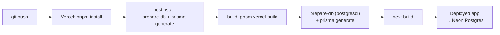

# Deploying Evently to Vercel

The app is a single Next.js project, so it deploys as one Vercel project. The only thing
that needs care is the database: **local development runs on SQLite, production runs on
Postgres.**

That switch is handled by `scripts/prepare-db.mjs`, which rewrites
`datasource db { provider = … }` based on the `DATABASE_PROVIDER` environment variable. It
runs automatically in `postinstall` and in the `vercel-build` script, so you never hand-edit
the schema.

| Environment | `DATABASE_PROVIDER` | Result                                                    |
| ----------- | ------------------- | --------------------------------------------------------- |
| Local       | _(unset)_           | schema stays on `sqlite`, `prisma/dev.db`                 |
| Vercel      | `postgresql`        | schema rewritten at build time, Postgres client generated |



---

## 1. Create the Postgres database (Neon)

1. Sign up at [neon.tech](https://neon.tech) and create a project (the free tier is enough).
2. Copy **two** connection strings from the dashboard:
   - the **pooled** one (host contains `-pooler`) → use this as `DATABASE_URL`
   - the **direct** one → handy for running `db push` / `db seed` from your machine
3. Make sure the string ends with `?sslmode=require`.

Supabase, Railway or any managed Postgres work the same way — only the connection string
changes.

## 2. Create the schema and seed the production database

Run these from your machine once, against the **direct** (non-pooled) URL:

```bash
# Point the local tooling at the production database
export DATABASE_URL="postgresql://…@…neon.tech/neondb?sslmode=require"   # Windows: $env:DATABASE_URL="…"

# Switch the schema to Postgres, create the tables, seed demo data
pnpm db:use-postgres
pnpm prisma db push
pnpm db:seed

# Switch back so local development keeps using SQLite
pnpm db:use-sqlite
```

`db push` is used instead of `migrate deploy` because the committed migration was generated
for SQLite; the schema contains no engine-specific features, so creating the tables from the
current schema is safe and produces an identical structure.

`pnpm db:seed` creates 12 events across 8 categories plus the three test logins, which is
what the submission checklist asks for.

> If you would rather keep local Postgres, skip the `db:use-sqlite` step and put the Postgres
> URL in `.env` permanently.

## 3. Push to GitHub

```bash
git add -A
git commit -m "Add deployment configuration"
git push origin main
```

## 4. Import the project into Vercel

1. [vercel.com/new](https://vercel.com/new) → **Import Git Repository** → pick the repo.
2. Vercel auto-detects Next.js. Leave the defaults — `vercel.json` already sets:
   - Install Command: `pnpm install`
   - Build Command: `pnpm vercel-build`
3. Before clicking Deploy, open **Environment Variables** and add the following for
   _Production_ (and _Preview_ if you want preview deploys to work):

| Variable                   | Value                           | Notes                                        |
| -------------------------- | ------------------------------- | -------------------------------------------- |
| `DATABASE_URL`             | Neon **pooled** string          | must include `?sslmode=require`              |
| `DATABASE_PROVIDER`        | `postgresql`                    | triggers the schema swap at build time       |
| `JWT_ACCESS_SECRET`        | 64-char random hex              | **different** from local                     |
| `JWT_REFRESH_SECRET`       | 64-char random hex              | **different** from the access secret         |
| `ACCESS_TOKEN_TTL_MINUTES` | `15`                            | optional                                     |
| `REFRESH_TOKEN_TTL_DAYS`   | `7`                             | optional                                     |
| `NEXT_PUBLIC_APP_URL`      | `https://your-app.vercel.app`   | used in notification links                   |
| `SEED_ADMIN_EMAIL`         | `admin@evently.test`            | optional, only used by the seed              |
| `SEED_ADMIN_PASSWORD`      | a strong password               | optional, only used by the seed              |
| `RESEND_API_KEY`           | _(leave empty)_                 | without it, OTP codes are logged server-side |
| `EMAIL_FROM`               | `Evently <no-reply@yourdomain>` | optional                                     |

Generate the secrets with:

```bash
node -e "console.log(require('crypto').randomBytes(32).toString('hex'))"
```

4. **Deploy.**

## 5. Verify the deployment

```bash
curl https://your-app.vercel.app/api/health
# {"success":true,"data":{"status":"ok","timestamp":"…"}}
```

Then in the browser:

- [ ] `/` shows the landing page with featured events
- [ ] `/events` lists and filters the seeded events
- [ ] Sign in as `admin@evently.test` and open `/admin/events`
- [ ] Book a ticket, complete the mock payment, and see the QR ticket under `/tickets`
- [ ] `/organizer/check-in` opens the camera on a phone (needs HTTPS — Vercel provides it)

## 6. Redeploying and schema changes

- **Code changes:** just push to `main`. Vercel rebuilds and redeploys.
- **Schema changes:** edit `prisma/schema.prisma`, then either
  - for a quick sync: `pnpm db:use-postgres && pnpm prisma db push && pnpm db:use-sqlite`, or
  - for a proper migration history: keep two migration sets, or standardise on Postgres for
    local development and use `pnpm db:migrate` normally.
- **Rotating a secret:** update it in Vercel → Settings → Environment Variables, then
  **redeploy** (env changes do not apply to a running deployment).

## Troubleshooting

| Symptom                                                    | Cause                                                                 | Fix                                                      |
| ---------------------------------------------------------- | --------------------------------------------------------------------- | -------------------------------------------------------- |
| `PrismaClientInitializationError` / "Can't reach database" | `DATABASE_URL` missing or wrong on Vercel                             | Re-check the pooled string, including `?sslmode=require` |
| "The table `main.User` does not exist"                     | Schema never pushed to Postgres                                       | Run step 2                                               |
| Login fails on the live site                               | Database not seeded                                                   | Run `pnpm db:seed` against the production URL            |
| `prisma generate` errors about the provider                | `DATABASE_PROVIDER` set to something other than `postgresql`/`sqlite` | Fix the value; the script rejects anything else          |
| Build fails with "Cannot find module '.prisma/client'"     | `prisma generate` didn't run                                          | Confirm the Build Command is `pnpm vercel-build`         |
| Notification links point at `localhost`                    | `NEXT_PUBLIC_APP_URL` not set at build time                           | Set it and redeploy (it is inlined during the build)     |
| Camera scanner says the browser can't open the camera      | Page not served over HTTPS                                            | Use the Vercel URL, not a plain-HTTP host                |
| Sessions drop immediately                                  | `JWT_*_SECRET` changed between deploys                                | Set the secrets once and keep them stable                |

## Cost

Everything in this guide fits the free tiers: Vercel Hobby for the app and Neon's free
Postgres plan. No payment gateway, email provider or storage bucket is required.
