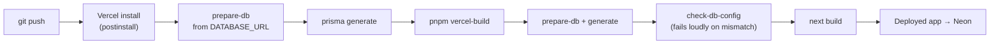

# Deploying Evently to Vercel

The app is a single Next.js project, so it deploys as one Vercel project. The database is
managed Postgres (Neon), and **the Prisma provider follows `DATABASE_URL` automatically** —
there is no flag to set and no schema to hand-edit.

`scripts/prepare-db.mjs` reads the URL scheme before generating the client:

| `DATABASE_URL` starts with      | Provider set in `prisma/schema.prisma` |
| ------------------------------- | -------------------------------------- |
| `postgres://` / `postgresql://` | `postgresql`                           |
| `file:`                         | `sqlite`                               |

If an explicit override (`DATABASE_PROVIDER`, or a `--postgres` / `--sqlite` flag) contradicts
the URL, the script **exits with an error** rather than generating a client that cannot
connect. After generating, `scripts/check-db-config.mjs` instantiates the Prisma client, so a
mismatch fails the build instead of shipping a deployment that 500s at runtime.



---

## 1. Create the Postgres database (Neon)

1. Sign up at [neon.tech](https://neon.tech) and create a project (the free tier is enough).
2. Copy **two** connection strings from the dashboard:
   - the **pooled** one (host contains `-pooler`) → use this as `DATABASE_URL` on Vercel
   - the **direct** one → used by `db push` / `db seed` from your machine
3. Make sure the string ends with `?sslmode=require`.

Supabase, Railway or any managed Postgres work the same way — only the connection string
changes.

> **Region:** keep the Vercel function region close to the database. Neon in `us-east-1`
> pairs with Vercel's default `iad1`. A cross-region hop adds latency to every query.

## 2. Create the schema and seed the data

Put the **direct** URL in `.env`, then:

```bash
pnpm db:push     # create the tables from prisma/schema.prisma
pnpm db:seed     # 12 events, 8 categories, the three test logins
```

That's the whole database setup. The project uses `prisma db push` (declarative sync) rather
than migration files, so the same two commands work against any Postgres database and there
is no SQLite/Postgres migration mismatch to manage.

`pnpm db:seed` is idempotent but **destructive** — it clears existing rows first. Never run it
against a database whose data you want to keep.

## 3. Push to GitHub

```bash
git add -A
git commit -m "…"
git push origin main
```

## 4. Import the project into Vercel

1. [vercel.com/new](https://vercel.com/new) → **Import Git Repository** → pick the repo.
2. Vercel detects Next.js. `vercel.json` sets:
   - Install Command: `pnpm install`
   - Build Command: `pnpm vercel-build`
3. Before deploying, add these under **Environment Variables** for **Production _and_
   Preview** (a Preview deploy will fail without them):

| Variable                   | Value                           | Notes                                        |
| -------------------------- | ------------------------------- | -------------------------------------------- |
| `DATABASE_URL`             | Neon **pooled** string          | must include `?sslmode=require`              |
| `JWT_ACCESS_SECRET`        | 64-char random hex              | **different** from local                     |
| `JWT_REFRESH_SECRET`       | 64-char random hex              | **different** from the access secret         |
| `NEXT_PUBLIC_APP_URL`      | `https://your-app.vercel.app`   | used in notification links; inlined at build |
| `ACCESS_TOKEN_TTL_MINUTES` | `15`                            | optional                                     |
| `REFRESH_TOKEN_TTL_DAYS`   | `7`                             | optional                                     |
| `SEED_ADMIN_EMAIL`         | `admin@evently.test`            | optional, only read by the seed              |
| `SEED_ADMIN_PASSWORD`      | a strong password               | optional, only read by the seed              |
| `RESEND_API_KEY`           | _(leave empty)_                 | without it, OTP codes are logged server-side |
| `EMAIL_FROM`               | `Evently <no-reply@yourdomain>` | optional                                     |

`DATABASE_PROVIDER` is **not** required — the provider follows `DATABASE_URL`.

Generate the secrets with:

```bash
node -e "console.log(require('crypto').randomBytes(32).toString('hex'))"
```

4. **Deploy.**

## 5. Verify the deployment

```bash
curl https://your-app.vercel.app/api/health
# {"success":true,"data":{"status":"ok","timestamp":"…"}}
```

The build log should contain these two lines — they are the fingerprint that the database
wiring ran:

```
[prepare-db] provider "postgresql" already set (via DATABASE_URL).
[check-db] Prisma client initialised for a "postgresql" datasource.
```

Then in the browser:

- [ ] `/` shows the landing page with featured events
- [ ] `/events` lists and filters the seeded events
- [ ] Sign in as `admin@evently.test` and open `/admin/events`
- [ ] Book a ticket, complete the mock payment, and see the QR ticket under `/tickets`
- [ ] `/organizer/check-in` opens the camera on a phone (needs HTTPS — Vercel provides it)

## 6. Redeploying and schema changes

- **Code changes:** push to `main`; Vercel rebuilds and redeploys.
- **Schema changes:** edit `prisma/schema.prisma`, then run `pnpm db:push` against the
  database. Nothing else to update — the provider always follows the URL.
- **Rotating a secret / changing any env var:** update it in Vercel → Settings → Environment
  Variables, then **redeploy**. Environment changes do not apply to an existing deployment.

## Troubleshooting

| Symptom                                                               | Cause                                                                  | Fix                                                                            |
| --------------------------------------------------------------------- | ---------------------------------------------------------------------- | ------------------------------------------------------------------------------ |
| `the URL must start with the protocol 'file:'`                        | A `sqlite` client was generated while `DATABASE_URL` is a Postgres URL | Deploy the current commit; then **Redeploy without build cache** once          |
| Build fails with `[prepare-db] Refusing to continue…`                 | `DATABASE_PROVIDER` (or a flag) contradicts `DATABASE_URL`             | Unset the override so the provider can follow the URL                          |
| Build fails with `[check-db] … cannot read DATABASE_URL`              | `DATABASE_URL` missing on that environment, or the wrong one           | Add it to Production **and** Preview, then redeploy                            |
| `PrismaClientInitializationError` / "Can't reach database" at runtime | Bad connection string, or the database is suspended                    | Re-check the pooled string including `?sslmode=require`; wake the Neon project |
| "The table `public.User` does not exist"                              | Schema never pushed                                                    | Run step 2 against the production URL                                          |
| Login fails on the live site                                          | Database not seeded                                                    | Run `pnpm db:seed` against the production URL                                  |
| Prepared-statement or connection-pool errors                          | Using the direct URL from serverless functions                         | Use the pooled Neon URL, or append `&pgbouncer=true`                           |
| Notification links point at `localhost`                               | `NEXT_PUBLIC_APP_URL` not set at build time                            | Set it and redeploy (it is inlined during the build)                           |
| Camera scanner says the browser can't open the camera                 | Page not served over HTTPS                                             | Use the Vercel URL                                                             |
| Sessions drop immediately                                             | `JWT_*_SECRET` changed between deploys                                 | Set the secrets once and keep them stable                                      |

### The one that catches everyone

A `sqlite` provider with a Postgres URL does **not** always fail the build: during route
collection Next.js can log the Prisma error and still report `Build Completed`, producing a
green deployment that 500s on every database call. That is why `check-db-config.mjs` runs
between `prisma generate` and `next build` — it turns that silent breakage into a red build.
If you are unsure whether a deployment is healthy, trust `/api/health`, not the build badge.

## Cost

Everything here fits the free tiers: Vercel Hobby for the app and Neon's free Postgres plan.
No payment gateway, email provider or storage bucket is required.
