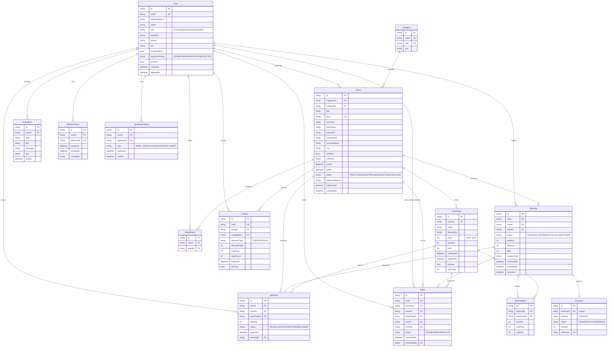

# Database schema (ER diagram)

Engine: **SQLite** in development (`prisma/dev.db`), **PostgreSQL** in production. Enums are
modelled as validated `String` columns so the same schema works on both engines; money is
stored as integer minor units (paise/cents).



## Notes

- **No overselling:** `TicketType.sold` is only ever incremented through a conditional
  `UPDATE … WHERE sold + n <= quantity`, so concurrent checkouts cannot exceed capacity.
- **Money:** every monetary column is an `Int` of minor units. `formatMoney()` renders it.
- **Single-use tickets:** check-in is a conditional update on `Ticket.status = 'VALID'`.
- **Indexes:** `Event(status, startAt)`, `Event(organizerId)`, `Event(city)`,
  `Booking(userId, status)`, `Ticket(userId, status)`, `SeatHold(status, expiresAt)`.
- **Payments:** `Payment` stores only the method, status, amount and a mock reference. Card
  numbers, CVCs and UPI IDs are never accepted or persisted.

## Migrations and seeding

```bash
pnpm db:migrate    # create/apply migrations in development
pnpm db:seed       # 8 users, 8 categories, 12 events, 25 ticket types, a demo booking
pnpm db:deploy     # apply migrations in production
pnpm db:studio     # browse the data
```
