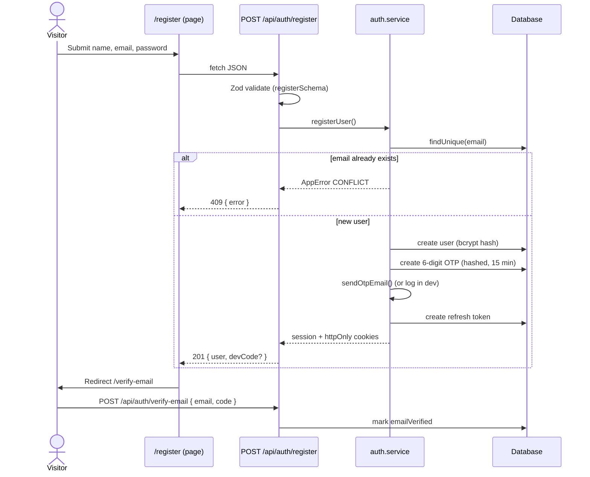
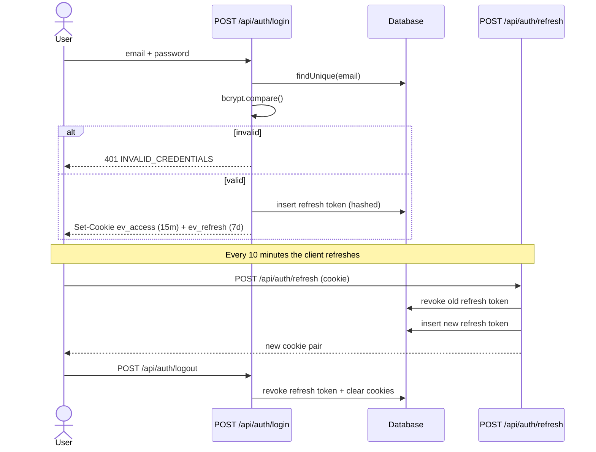
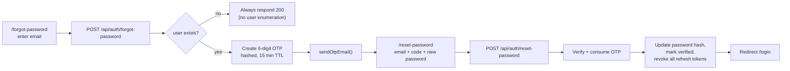
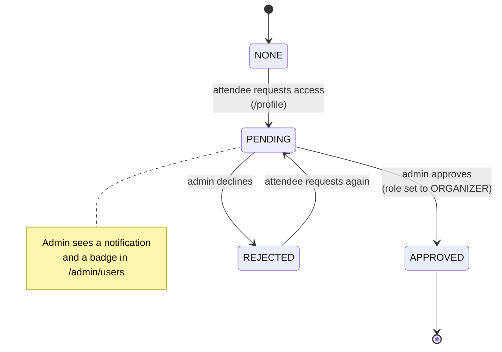
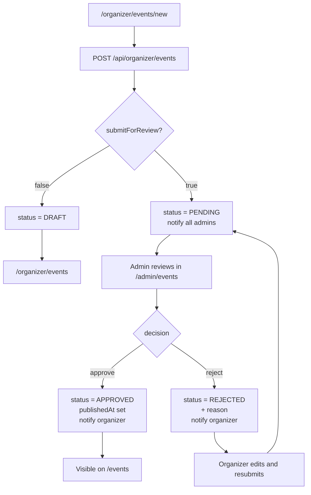
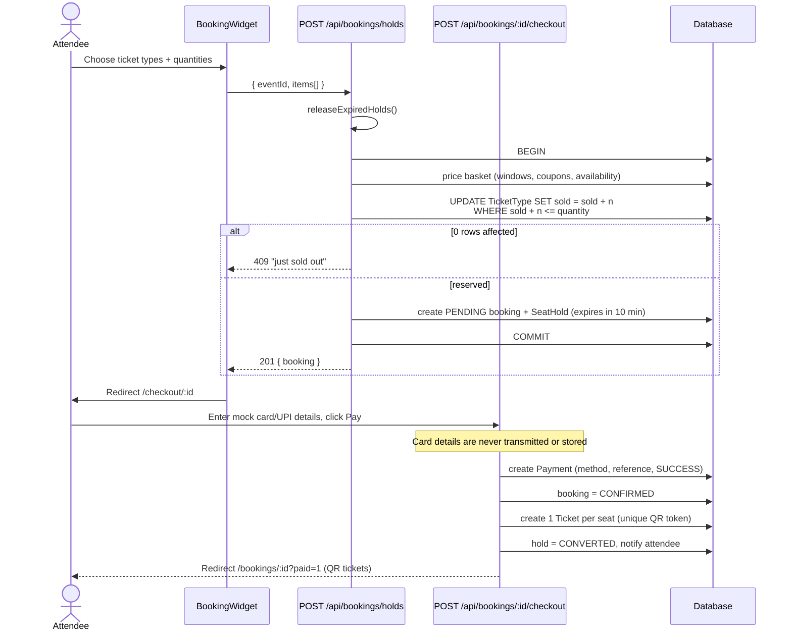
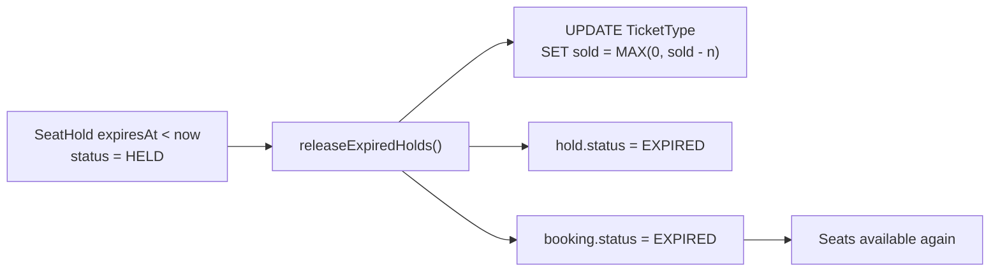
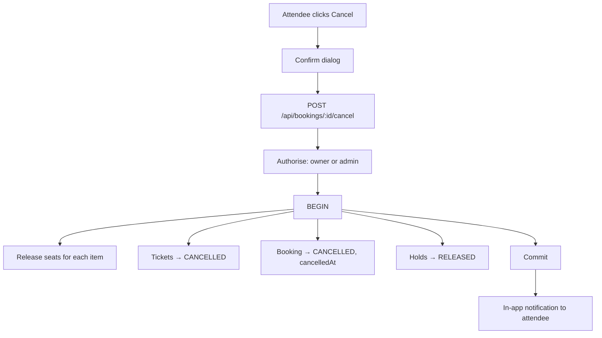
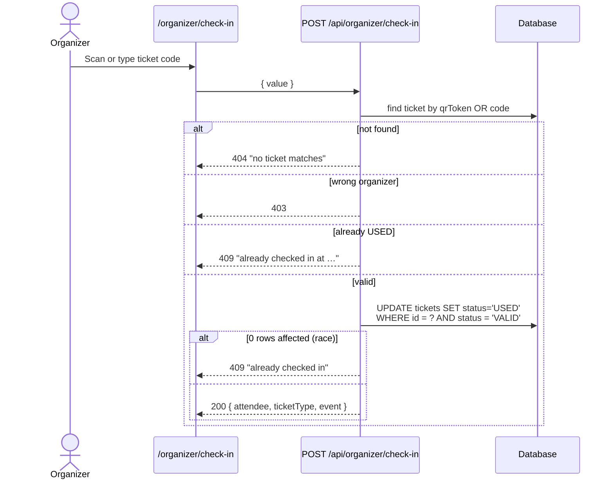

# Flow diagrams

All flows are shown as Mermaid diagrams so they render on GitHub and stay in sync with the
code.

## 1. Sign up (register → verify email)

## 2. Log in / log out

## 3. Forgot / reset password

## 4. Organizer approval

## 5. Event creation and publishing

## 6. Ticket booking (select → hold → pay → confirm → ticket)

## 7. Seat hold expiry

## 8. Booking cancellation

## 9. QR check-in (single use)

